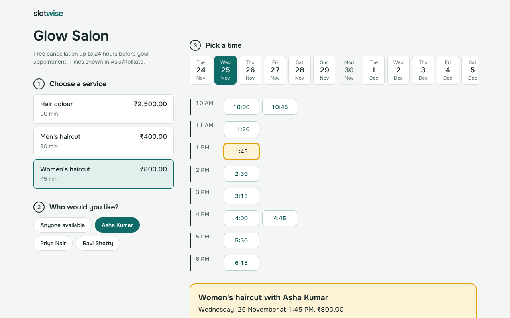
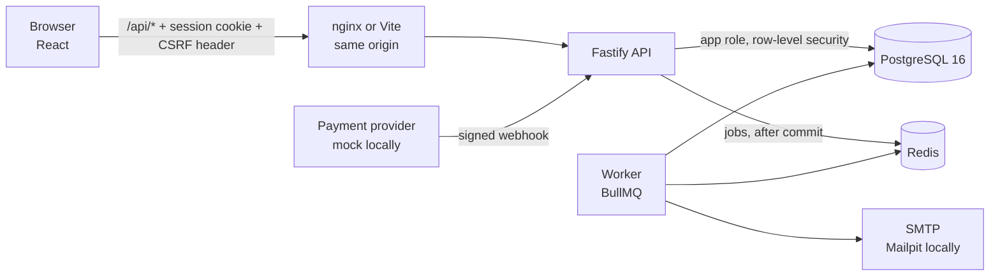

# Slotwise

Booking software that many small service businesses (salons, clinics, coaching centres)
share. Each business gets a booking page where customers pick a service, a person and a
time and pay online; owners manage services, staff hours and bookings. The hard parts are
the ones a shared booking system can't get wrong: one business must never see another's
data, a slot must never be sold twice, and a booking is confirmed only by a payment the
system can verify.

It runs locally and offline: no accounts, API keys or cloud services. Payments use a mock
provider that sends signed webhooks through the real payment code.



## Architecture



**How a booking flows.** The browser sends `POST /bookings/hold` through the same-origin
proxy. The API checks the session, CSRF token and role, validates the body with a Zod
schema shared with the frontend, and opens a transaction scoped to the business
(`withTenant` sets the tenant for row-level security). It checks the time is a real open
slot, takes a lock on that staff member's calendar, and inserts the booking as `HELD`. If
another request got there first, the database's exclusion constraint rejects the insert
and the customer gets a 409. After the transaction commits, a job to expire the hold in 10
minutes is queued. The customer pays; the provider's signed webhook confirms the booking
and writes confirmation and reminder emails as rows in the same transaction; the worker
sends them. A reconciler runs every minute and re-queues anything a lost job missed.

| Directory         | Contents                                                                                                                                                                              |
| ----------------- | ------------------------------------------------------------------------------------------------------------------------------------------------------------------------------------- |
| `apps/api`        | Fastify API and the worker (same code, two entry points), migrations, tests                                                                                                           |
| `apps/web`        | React app: public booking page, owner, staff and customer pages                                                                                                                       |
| `packages/shared` | Zod schemas and rules used by both                                                                                                                                                    |
| `e2e`             | Playwright browser tests, including accessibility checks                                                                                                                              |
| `ops`             | Prometheus scrape config and alert rules (with tests), Grafana dashboard                                                                                                              |
| `docs`            | [ADRs](docs/adr/README.md), [walkthrough](docs/WALKTHROUGH.md), [runbook](docs/RUNBOOK.md), [security review](docs/SECURITY.md), [audit](docs/AUDIT.md), [OpenAPI](docs/openapi.json) |

## Quick start

Requirements: Node 22, pnpm 10, Docker (Docker Desktop on Windows, started).

**Development (hot reload):**

```bash
pnpm bootstrap   # install, start Postgres/Redis/Mailpit, create apps/api/.env, migrate, seed
pnpm dev         # API :3000, worker, web on http://localhost:5173
```

Open http://localhost:5173/b/glow-salon. Emails land in Mailpit at http://localhost:8025.

**Everything in Docker:**

```bash
docker compose --profile full up --build                          # app at http://localhost:8080
docker compose --profile full --profile observability up --build  # plus Prometheus :9090 and Grafana :3001
```

**Tests:**

```bash
pnpm test                               # unit and integration (needs the containers from bootstrap)
pnpm exec playwright install chromium   # once
pnpm test:e2e                           # browser tests; starts API, worker and web itself
```

Demo logins (password `password123`): owner `owner@glow.demo`, staff `asha@glow.demo`,
owner of a second business `owner@sunrise.demo`, customer `customer@demo.test`.

Every port is bound to `127.0.0.1`; nothing is reachable from other devices. API docs are
at `/api/docs`; backups and alerts are covered in the [runbook](docs/RUNBOOK.md).

## Design decisions and trade-offs

| Decision                                                                                                                                                  | Rejected                                            | Why                                                                                                                      |
| --------------------------------------------------------------------------------------------------------------------------------------------------------- | --------------------------------------------------- | ------------------------------------------------------------------------------------------------------------------------ |
| Tenant isolation in the types, in Postgres row-level security, and in composite foreign keys ([0003](docs/adr/0003-tenant-isolation-with-rls.md))         | Filtering in application code only                  | One forgotten `WHERE` would leak data; with RLS and an app role that owns no tables, a missing filter returns nothing.   |
| An exclusion constraint decides double booking; an advisory lock per staff calendar avoids deadlocks ([0004](docs/adr/0004-preventing-double-booking.md)) | Check-then-insert; `SERIALIZABLE` with retries      | Check-then-insert races. The lock was added after a concurrency test produced deadlocks under the constraint alone.      |
| Only the signed webhook confirms a payment, idempotent by event id ([0007](docs/adr/0007-payments-confirmed-by-webhook.md))                               | Confirming on the browser redirect                  | Redirects can be faked or lost; webhooks arrive twice or late, and each case is tested.                                  |
| Outbox rows, after-commit jobs and a reconciler ([0008](docs/adr/0008-outbox-and-reconciler.md))                                                          | Queueing inside the transaction; trusting the queue | Jobs never act on rolled-back changes, and losing Redis loses no email or refund. Email becomes at-least-once.           |
| Kysely and hand-written SQL migrations ([0002](docs/adr/0002-kysely-and-sql-migrations.md))                                                               | Prisma, Drizzle                                     | The core features are Postgres-specific (RLS, exclusion constraints, savepoints); an ORM would hide them behind raw SQL. |
| Server-side sessions with CSRF tokens ([0006](docs/adr/0006-sessions-csrf-and-rate-limits.md))                                                            | JWTs, an auth framework                             | Sessions can be revoked at once; signup creates a business in one transaction. No MFA or social login yet.               |
| Local and offline only ([0010](docs/adr/0010-local-only.md))                                                                                              | Hosted error tracking, a cloud deployment guide     | It is shown running on a laptop; cloud pieces would be code to explain with no use.                                      |

The other eight ADRs cover the shared schemas, the state machine, time zones, metrics and
alerts, generated API docs, backups and migrations, account erasure, and timeouts.

Tests: 85 unit and 260 integration tests for the API (against real Postgres and Redis),
12 for the web app, 1 for the shared package, and 14 browser tests. The integration tests
include 20 simultaneous requests for one slot, duplicate and forged webhooks, cross-tenant
access attempts, every migration rolled back and re-applied, and a backup restored into a
scratch database. CI runs lint, type-checking, the tests with coverage thresholds, the
browser tests, a dependency audit, Docker builds with an image vulnerability scan, and
checks of the monitoring configuration.

## Benchmarks

`pnpm bench` starts the real API with real Postgres and Redis, creates a business with 10
staff, and sends concurrent HTTP requests. Two runs, 20 concurrent connections:

```
Machine:  Intel(R) Xeon(R) Processor @ 2.10GHz, 2 logical CPUs, 8024 MB RAM
System:   Linux 6.18.44 (x64), Node v22.23.5, Postgres 16.15, Redis 7.0.15
Memory:   peak 282-306 MB resident (API and load generator share one process)
Date:     2026-11-24
```

| Scenario                          | Throughput    | p50        | p95        | p99        | Responses |
| --------------------------------- | ------------- | ---------- | ---------- | ---------- | --------- |
| `GET` slots for a day (2,000)     | 344-361 req/s | 52-55 ms   | 91-93 ms   | 114-121 ms | all 200   |
| `POST` hold, all on 1 staff (600) | 135-136 req/s | 143 ms     | 225-235 ms | 265-275 ms | all 201   |
| `POST` hold, spread over 10 (600) | 147-150 req/s | 130-133 ms | 180-191 ms | 196-215 ms | all 201   |

This is a 2-CPU Linux VM running the API, Postgres, Redis and the load generator together,
so the numbers are a floor rather than a capacity figure. Funnelling every write through one
staff member's lock costs about 9% throughput compared with spreading writes over ten. Run
`pnpm bench` to measure your own machine; it prints the same block.

## Known limitations

- Everything runs on one Postgres. Writes for one staff member are serialised (milliseconds
  each), which only matters far beyond a small business's booking rate.
- Slot lookups are the busiest request and aren't cached.
- Authentication is the project's own code: no MFA or social login.
- Emails are at-least-once: a crash at the wrong moment can send one twice, never lose one.
- The API docs list routes separately from where they're registered. Tests catch a missing
  route or a wrong access rule, not a wrong request schema ([0012](docs/adr/0012-api-docs-from-validation-schemas.md)).
- INR and one payment provider only; no tax invoices.
- The benchmark and the audit ran on a Linux VM. The Docker setup with the monitoring profile
  has not yet been re-run on the Windows laptop since the upgrade.

## What's next

1. Cache slot lookups for a few seconds per staff member and day, and measure the change.
2. MFA for owners.
3. WhatsApp reminders, which customers in India read more than email.
4. An owner calendar view with drag-to-reschedule, and CSV export of bookings.
