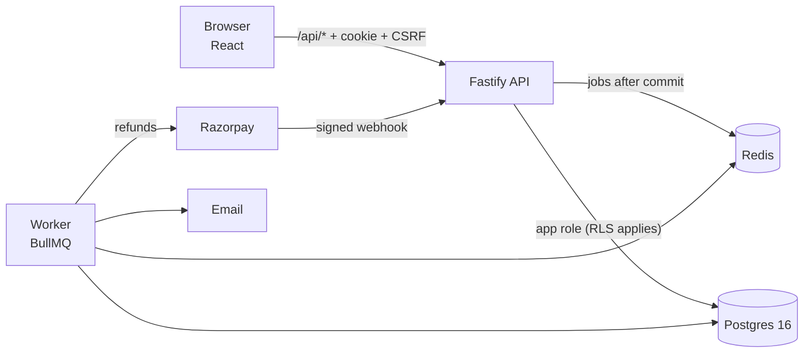

# Slotwise

**Multi-tenant booking for small service businesses.** Salons, clinics and coaching centres each get a booking page (`/b/your-business`). Customers pick a service, a person (or "anyone available") and a time, pay by UPI or card through Razorpay, and get a confirmation and a reminder the day before. Owners manage services, staff hours and bookings; staff see their schedule. Every business's data is walled off from every other's, a slot can never be sold twice, and payments are confirmed only by the payment provider's signed webhook.

> Built as a portfolio project to industry standards: 350 automated tests, CI, Docker, monitoring with alerts, API docs, backups, and written design decisions. See [`docs/DECISIONS.md`](docs/DECISIONS.md) and [`docs/LEARNING.md`](docs/LEARNING.md).

---

## Demo

Slotwise runs locally; it isn't hosted publicly. Payments use a built-in test mode that sends real signed webhooks through the real payment code, so no Razorpay account is needed.

- **Video:** _2–3 minute walkthrough to be recorded_
- **Run it yourself in one command:** see [Run locally](#run-locally)
- **Deploying (optional):** [`docs/DEPLOY.md`](docs/DEPLOY.md)

Demo logins (password for all: `password123`):

| Role     | Email                | Business                                    |
| -------- | -------------------- | ------------------------------------------- |
| Owner    | `owner@glow.demo`    | Glow Salon (`/b/glow-salon`)                |
| Staff    | `asha@glow.demo`     | Glow Salon                                  |
| Owner    | `owner@sunrise.demo` | Sunrise Physio Clinic (`/b/sunrise-clinic`) |
| Customer | `customer@demo.test` | both                                        |

---

## Architecture



More diagrams (request lifecycle, payment sequence, booking states) are in [`docs/ARCHITECTURE.md`](docs/ARCHITECTURE.md).

---

## The three hard problems

### 1. Tenant isolation: one business can never see another's data

- **Application layer:** every data-access function takes a `TenantTx`, which you can only get from `withTenant(db, tenantId, …)`. Forgetting the tenant is a **type error**. Every query also filters by `tenant_id`.
- **Database layer:** PostgreSQL **Row-Level Security** on every tenant table: `tenant_id = app_current_tenant()`, set per transaction with `set_config(…, true)`. The API connects as a role that **owns no tables**, so RLS can't be skipped. With no tenant set, queries return zero rows (fails closed).
- **Referential layer:** composite foreign keys `(id, tenant_id)`, so a booking can't point at another tenant's service.
- **Tested:** cross-tenant reads/updates/deletes over HTTP return 404, a raw SQL query with the wrong tenant returns nothing, a pooled connection doesn't leak the previous tenant, and a role × route matrix covers every endpoint.

### 2. No double booking, even at the same millisecond

- A Postgres **exclusion constraint** on `(staff, tstzrange(start, end))` for HELD/CONFIRMED bookings. The **database** is the referee, not an `if` in code.
- **Tested:** 20 customers request the same slot in parallel, 10 runs in a row: exactly one `201`, nineteen `409`.
- **A real bug this test found:** concurrent inserts under an exclusion constraint can **deadlock** in Postgres (each waits for the other's uncommitted row). Losers got 500s after up to 20 s. Fix: a per-staff `pg_advisory_xact_lock` so writers take turns. The constraint is still the guarantee, and the test asserts ~120/190 losers are stopped by it. ([D19](docs/DECISIONS.md))

### 3. Payments you can trust

- The amount comes from the **database**, never the browser. One open order per booking (unique index).
- The **webhook** is the source of truth: HMAC-SHA256 checked on the **raw** body. Recording the event id (UNIQUE) and applying it happen in **one transaction**, so duplicates and crashes are safe.
- **Late payment** after the hold expired: re-confirm inside a **savepoint** if the slot is still free, otherwise automatically refund and email the customer.
- Refunds run as a retrying background job that first checks whether the refund already exists.
- **Tested:** valid, duplicate (×5 in parallel), forged, tampered, failed-then-retried, late-with-free-slot, late-with-taken-slot, refund on cancellation, refund crash recovery, plus a browser E2E run of the full pay-and-cancel flow.

---

## Tech stack

| Layer         | Choice                                                                     | Why                                                                       |
| ------------- | -------------------------------------------------------------------------- | ------------------------------------------------------------------------- |
| Language      | TypeScript (strict) everywhere                                             | One language, compile-time safety across API, UI and shared schemas       |
| Monorepo      | pnpm workspaces                                                            | Shared Zod schemas change in the same commit as their users               |
| API           | Fastify                                                                    | Fast, plugin-based, `inject()` makes HTTP tests quick                     |
| Validation    | Zod (shared package)                                                       | Same rules in the browser and on the server                               |
| Database      | PostgreSQL 16                                                              | RLS, exclusion constraints, savepoints, advisory locks                    |
| Query builder | Kysely + SQL migrations                                                    | Type-checked queries with the SQL still visible ([D3](docs/DECISIONS.md)) |
| Auth          | DB sessions, Argon2id (`@node-rs/argon2`)                                  | Revocable sessions, explainable code ([D10](docs/DECISIONS.md))           |
| Jobs          | BullMQ + Redis                                                             | Delayed jobs, retries with backoff, job schedulers                        |
| Payments      | Razorpay (+ a mock that drives the real webhook)                           | Indian payments; runnable without keys                                    |
| Email         | Nodemailer → Mailpit (dev) / any SMTP (prod)                               | Provider-agnostic                                                         |
| Frontend      | React, Vite, TanStack Query, React Router, Tailwind, React Hook Form       | Cached server state, typed forms, fast dev loop                           |
| Observability | pino (JSON logs + request ids), Prometheus + Grafana, `/health` + `/ready` | Debuggable in production; alerts with a runbook                           |
| Tests         | Vitest, Testing Library, Playwright + axe                                  | Unit → integration → browser + accessibility                              |
| Delivery      | Docker, docker compose, GitHub Actions                                     | One-command local run, CI on every push                                   |

---

## Tests

| Level       | What                                                                                                                                                                                                                                                                                   | Count                     | Run             |
| ----------- | -------------------------------------------------------------------------------------------------------------------------------------------------------------------------------------------------------------------------------------------------------------------------------------- | ------------------------- | --------------- |
| Unit        | Slot generator (DST, day boundaries, time off…), state machine (all 36 transitions), cancellation policy, "local only" guard on docker-compose, frontend helpers                                                                                                                       | 80 API + 9 web + 1 shared | `pnpm test`     |
| Integration | Real HTTP (Fastify `inject`) against real Postgres and Redis: auth, roles, tenant isolation, bookings, concurrency (incl. "anyone available"), payments, webhooks, jobs, SMTP, metrics, API docs coverage, migrations up/down, backup + restore drill, data export and account erasure | 246                       | `pnpm test`     |
| End-to-end  | Real Chrome: owner signup → service + hours → customer books and pays → owner sees it → customer cancels → refund; staff invite and password reset by following the real email links; download my data and delete my account; axe accessibility checks on main pages                   | 14                        | `pnpm test:e2e` |

API code coverage: **~92% of lines, ~80% of branches**. CI fails if it drops below 85% / 72% (`pnpm test:coverage`).

The integration tests create a fresh `slotwise_test` database and migrate it before every run. Each test makes its own tenants, so tests never depend on each other.

---

## Performance

On a 2-vCPU machine running the API, Postgres and Redis together: **~320 slot lookups/s** (p95 96 ms) and **~120 bookings held/s** (p95 210 ms) at 20 concurrent connections. The per-staff lock costs only ~5–8%. Details and method: [`docs/PERFORMANCE.md`](docs/PERFORMANCE.md).

---

## Run locally

**Everything in Docker (one command; on Windows, install and start Docker Desktop first):**

```bash
docker compose --profile full up --build
# App:   http://localhost:8080   (demo logins above)
# Email: http://localhost:8025   (Mailpit catches every email)
```

**For development (hot reload):**

```bash
pnpm i
docker compose up -d                  # Postgres, Redis, Mailpit
cp .env.example apps/api/.env
pnpm db:migrate && pnpm db:seed
pnpm dev                              # API on :3000, web on :5173
pnpm --filter @slotwise/api worker    # background jobs (second terminal)
```

**Tests:**

```bash
pnpm test                             # unit + integration (needs docker compose up -d)
pnpm exec playwright install chromium # once
pnpm test:e2e                         # starts API, worker and web itself
```

Requirements: Node 22, pnpm 10, Docker.

---

## Operating it

Everything below runs locally and is bound to `127.0.0.1`, so nothing is reachable from other devices.

| What                | How                                                                                                                                                     |
| ------------------- | ------------------------------------------------------------------------------------------------------------------------------------------------------- |
| API docs            | http://localhost:8080/api/docs (OpenAPI 3.1, generated from the same schemas that validate requests: [`docs/openapi.json`](docs/openapi.json))          |
| Monitoring          | `docker compose --profile full --profile observability up -d --build`, then Grafana at http://localhost:3001 and alerts at http://localhost:9090/alerts |
| Backups             | `pnpm db:backup`, then `pnpm db:restore-drill` to prove the backup restores (into a scratch database, never over live data)                             |
| When an alert fires | [`docs/RUNBOOK.md`](docs/RUNBOOK.md): one section per alert, plus backups and privacy requests                                                          |
| Privacy (DPDP Act)  | Customers download their data and erase their account from **Your account**                                                                             |

---

## Trade-offs and known limitations

- **Kysely instead of Prisma:** more hand-written SQL and hand-kept table types (a test checks they match the database), in exchange for direct use of RLS, constraints and savepoints.
- **Own session code instead of an auth library:** small and explainable, but no OAuth/social login or MFA yet.
- **Serialized writes per staff member** (advisory lock): fine for small businesses, a bottleneck only at very high booking rates for one person.
- **Emails are at-least-once:** a crash at the wrong moment can send a duplicate email; it never loses one.
- **Fixed slot grid** (steps of the service length): tidy times, but small gaps can go unused.
- **INR only, Razorpay only.** No tax/GST invoices.
- Built to run locally for demos. The deployment guide is written but has not been tried on a real host.

## What I'd build next

1. Record the walkthrough video.
2. Customer self-serve without an account (magic-link booking management).
3. Owner calendar view (drag to reschedule), and CSV export of bookings and payments.
4. WhatsApp reminders (Indian customers read WhatsApp more than email).
5. Per-account rate limits and MFA for owners.
6. Cache slot lookups for a few seconds per staff member and day (reads are the hot path; see PERFORMANCE.md).

---

## Docs

- [`docs/ARCHITECTURE.md`](docs/ARCHITECTURE.md): diagrams and code layout
- [`docs/DECISIONS.md`](docs/DECISIONS.md): every important choice, with alternatives and trade-offs
- [`docs/LEARNING.md`](docs/LEARNING.md): a plain-language explanation of each phase
- [`docs/SECURITY.md`](docs/SECURITY.md): OWASP Top 10:2025 self-review
- [`docs/DEPLOY.md`](docs/DEPLOY.md): how to deploy
- [`docs/PERFORMANCE.md`](docs/PERFORMANCE.md): load test results
- [`docs/INTERVIEW.md`](docs/INTERVIEW.md): likely interview questions and where the answers are in the code
- [`docs/EXERCISES.md`](docs/EXERCISES.md): hands-on changes to practise on this codebase
- [`docs/RUNBOOK.md`](docs/RUNBOOK.md): what to do when an alert fires; backups; privacy requests
- [`CONTRIBUTING.md`](CONTRIBUTING.md): the branch → pull request → CI workflow, and the rules that keep it safe
- [`CHANGELOG.md`](CHANGELOG.md): what changed in each version
