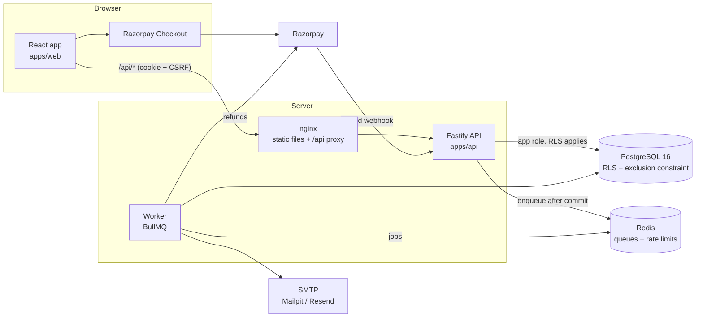
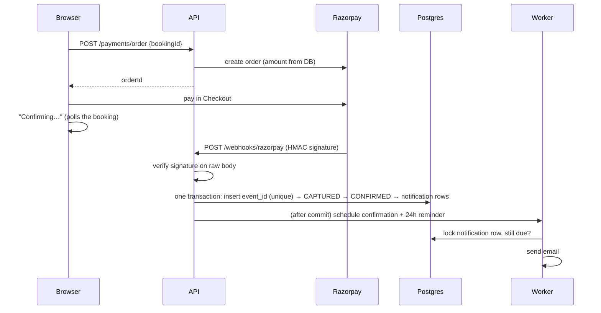
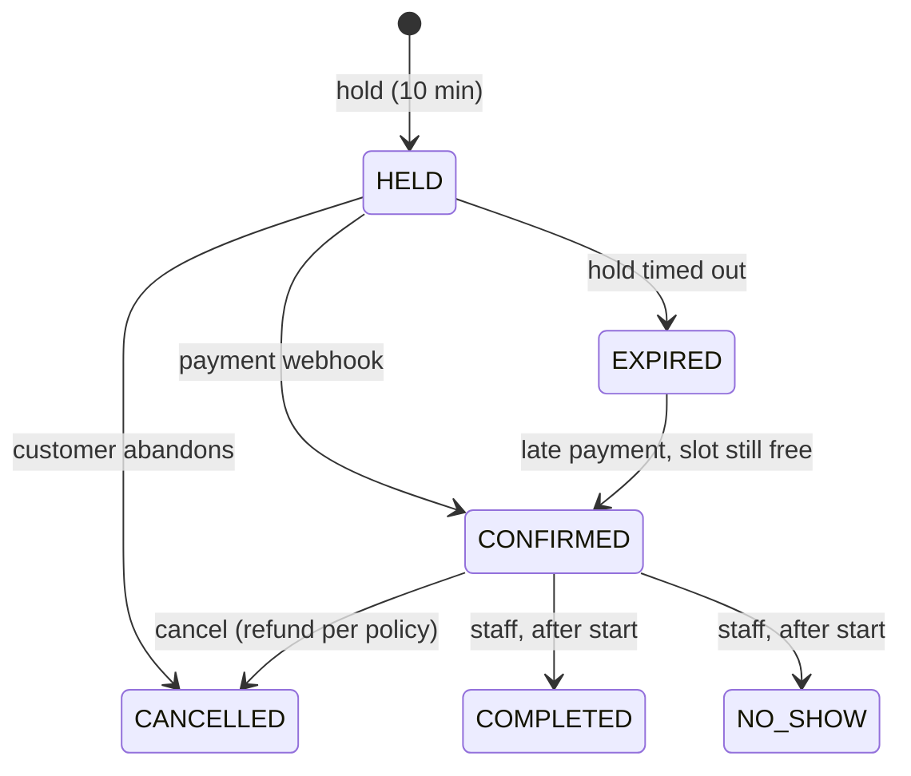

# Architecture

## The pieces



- **apps/web**: React + Vite. Talks only to `/api`, which nginx (production) or Vite (development) forwards to the API, so the browser sees a single origin.
- **apps/api**: Fastify. Validates input with the shared Zod schemas, runs every request in a tenant-scoped transaction, and queues background work after commit.
- **Worker**: the same codebase, a different entry point (`src/worker.ts`). Sends emails, expires holds, processes refunds, and runs the reconciler every minute.
- **packages/shared**: Zod schemas and types used by both the API and the frontend.

## A request, end to end

```mermaid
sequenceDiagram
  participant B as Browser
  participant API as Fastify
  participant DB as Postgres
  B->>API: POST /bookings/hold (cookie, x-csrf-token)
  API->>API: Origin check, session → req.auth, requireRole('CUSTOMER'), Zod parse
  API->>DB: BEGIN; set_config('app.tenant_id', …, true)
  API->>DB: is this a real slot? (slot generator)
  API->>DB: pg_advisory_xact_lock(staff); expire stale holds
  API->>DB: INSERT booking (HELD)
  alt exclusion constraint violated
    DB-->>API: 23P01
    API-->>B: 409 SLOT_TAKEN
  else inserted
    API->>DB: COMMIT
    API->>API: after commit: queue hold-expiry job
    API-->>B: 201 booking
  end
```

## Payment flow



## Booking states



## Code layout

```
apps/api/src/
  app.ts            builds the Fastify app (no listen) – used by tests
  index.ts          starts the API
  worker.ts         starts the background workers
  config.ts         environment variables, validated
  metrics.ts        Prometheus metrics and their internal server
  db/               connection, migrations, schema types, withTenant()
  http/             request authentication (sessions, CSRF, roles), error handler,
                    errors, input/output validation, path parameters
  modules/<area>/   repo.ts (data access) · service.ts (rules) · routes.ts (HTTP)
  jobs/             queues, BullMQ implementation, workers, post-commit effects
  credentials/      password hashing, random tokens
  mail/             SMTP mailer, HTML escaping for emails
  openapi/          the API description (OpenAPI 3.1) built from the route schemas
apps/api/scripts/ops/  backup and restore drill
apps/api/tests/
  unit/             pure logic: slot generator, state machine, cancellation policy
  integration/      HTTP + real Postgres + real Redis
  support/          test app, data factories, fakes for jobs and email
apps/web/src/
  api/              fetch client, query cache, session hooks (useMe, useLogin...)
  time/             formatting in the business's timezone, a ticking clock
  components/       UI kit, layouts
  features/         auth, booking, owner, staff, customer
e2e/                Playwright: critical paths + accessibility
ops/prometheus/     scrape config, alert rules and their unit tests
ops/grafana/        provisioned datasource and dashboard
docs/openapi.json   generated API description (kept in git so API changes show in review)
```

## Where each "hard problem" lives

| Problem           | Code                                                                                                                           | Tests                                                                                 |
| ----------------- | ------------------------------------------------------------------------------------------------------------------------------ | ------------------------------------------------------------------------------------- |
| Tenant isolation  | `db/tenant-tx.ts`, `migrations/0002_row_level_security.ts`, every `repo.ts`                                                    | `tenant-isolation.db.test.ts`, `catalog.test.ts`, `bookings.test.ts`, `roles.test.ts` |
| No double booking | `migrations/0001_init.ts` (exclusion constraint), `bookings/repo.ts` (`lockStaffCalendar`), `bookings/service.ts` (`holdSlot`) | `bookings.test.ts` (20 parallel holds × 10)                                           |
| Reliable payments | `payments/service.ts` (`handleWebhook`, `processRefund`), `payments/routes.ts` (raw body)                                      | `payments.test.ts`, `e2e/booking-flow.spec.ts`                                        |
